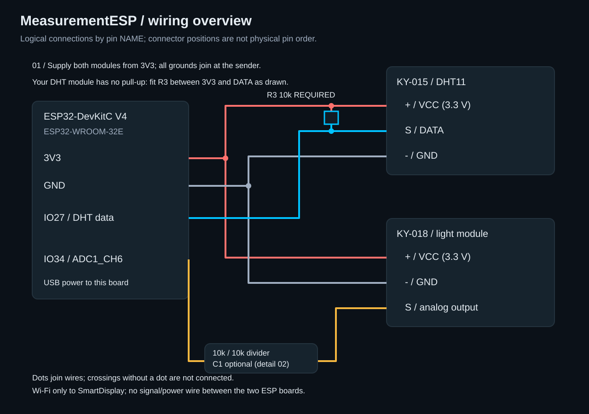
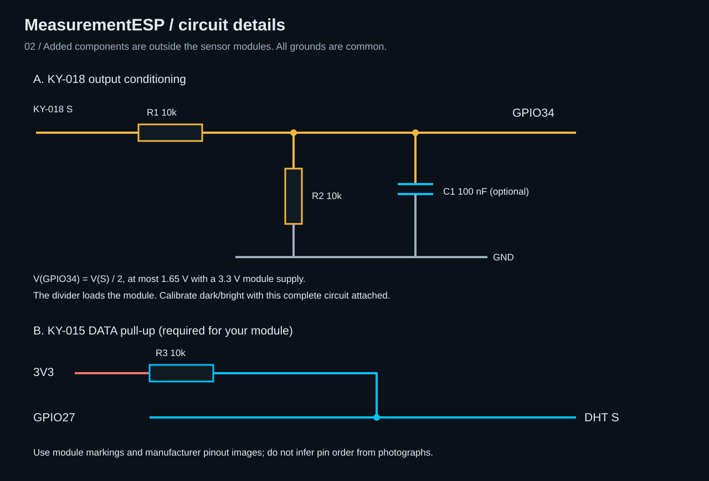
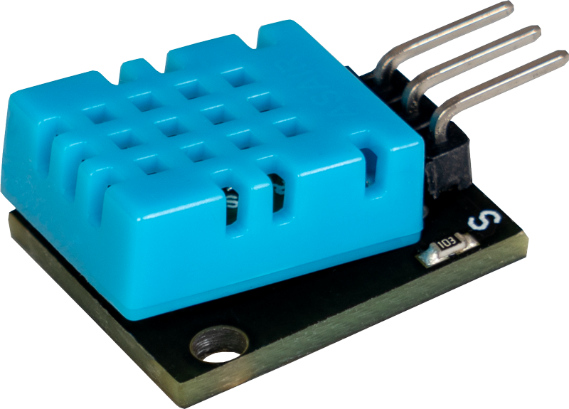
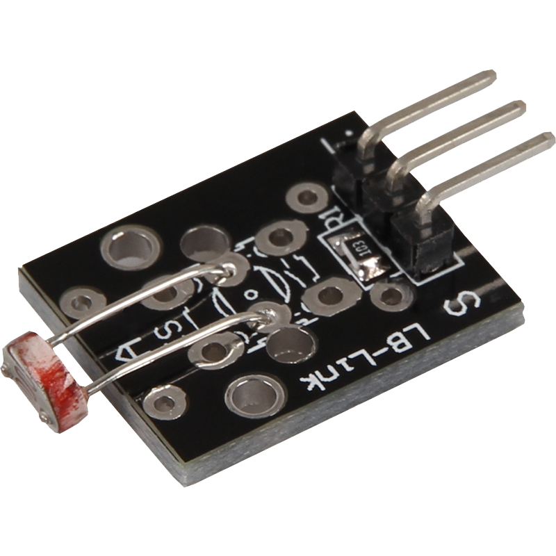

# MeasurementESP hardware reference

This design uses **ESP32-DevKitC V4 / ESP32-WROOM-32E**, **KY-015 / DHT11**, and
**KY-018 / LDR**. The sensors match cards 27 and 26 in
`D:/GitHub/AlSayad/35_sensor_photos_inline.html`. These are selected reference parts;
the user's physical module revisions have not been inspected.

Open [the illustrated offline guide](MeasurementESP_Hardware.html) for embedded
sensor photographs, manufacturer pinouts, and both wiring drawings.

## Implementation status

The sender now implements the DHT11 and ADC-light drivers. Physical sensor
acceptance remains incomplete. The user confirmed that their DHT11 module has
**no built-in pull-up**: fit external **R3, 10 kohm, from DATA/GPIO27 to 3V3**.
R3 is shown directly in the overview as well as the detailed circuit drawing.
The user has no C1; this 100 nF light-filter capacitor is optional and can be omitted
while retaining both light-divider resistors. Calibrate the circuit as actually built.

## Parts and connections

| Quantity | Component | Purpose |
| --- | --- | --- |
| 1 | ESP32-DevKitC V4 with ESP32-WROOM-32E | Sender; power by USB |
| 1 | KY-015 DHT11 module | Combined temperature and humidity |
| 1 | KY-018 analog LDR module | Relative light level |
| 2 | 10 kΩ resistor, preferably 1% | R1/R2 light-output divider |
| Optional 1 | 100 nF ceramic capacitor | C1 noise filter at ADC input; may be omitted |
| 1 | 10 kohm resistor | R3 DHT pull-up; required for your module |
| As needed | Breadboard and jumpers | Prototype connections |

| From | To |
| --- | --- |
| ESP32 3V3 | KY-015 +/VCC and KY-018 +/VCC |
| ESP32 GND | Both module −/GND pins, R2 lower end, C1 lower end |
| ESP32 IO27 | KY-015 S/DATA |
| KY-018 S | R1 10 kΩ upper end |
| R1 lower end | ESP32 IO34, R2 upper end, C1 upper end |
| R3 10 kohm (required here) | Between IO27/DATA and 3V3, not in series with DATA |





Module connectors vary. Identify **S**, **+**, and **−** on the actual PCB and
compare with the included manufacturer pinouts. The overview groups pins by
function and does not reproduce their physical header positions. Do not wire
from the photograph's apparent orientation alone. A bare four-pin DHT11 is a
different package from this three-pin module and needs its own pinout check.

Both modules use the sender's 3.3 V output. Keep DATA pull-ups at 3.3 V. Power
SmartDisplay separately; the two ESP boards communicate by Wi-Fi without a wired
connection. Use one board power source at a time.

## Sensor photographs





Photographs and manufacturer pinout SVGs are reference assets from Joy-IT /
SensorKit, using the original URLs linked by the user's sensor catalog. They are
not photographs of the user's physical components. Source pages:
[KY-015](https://sensorkit.joy-it.net/en/sensors/ky-015) and
[KY-018](https://sensorkit.joy-it.net/en/sensors/ky-018).

## Firmware requirements for this wiring

- Use GPIO27 as the DHT11 bidirectional digital data line. Read one combined
  temperature/humidity frame, verify its checksum, and distribute the two values
  to the shared measurement model. This is the DHT timing protocol, not Dallas
  1-Wire. Leave at least two seconds between physical acquisition attempts,
  including after failures; obey the selected sensor's startup delay.
- A failed combined DHT transaction marks both temperature and humidity `error`.
  Keep light acquisition independent. The referenced DHT11 module's specified
  ranges are 0–50 °C and 20–90 %RH, narrower than the receiver's accepted ranges.
  Its quoted accuracy is ±2 °C and ±5 %RH; it is a basic room-monitor sensor.
  [Joy-IT KY-015 specifications](https://sensorkit.joy-it.net/en/sensors/ky-015).
- GPIO34 is input-only and maps to ADC1 channel 6 on this board. Use ADC1 for
  the analog sensor because ADC2 shares hardware with Wi-Fi. GPIO27's ADC2
  capability is irrelevant here: it is used only as digital DHT data.
  [Espressif header mapping](https://documentation.espressif.com/esp-dev-kits/en/latest/esp32/esp32-devkitc/user_guide.html),
  [ADC hardware limitations](https://docs.espressif.com/projects/esp-idf/en/v5.4.2/esp32/api-reference/peripherals/adc_oneshot.html#hardware-limitations).
- Use the ESP-IDF ADC oneshot driver with the selected SDK's attenuation setting
  that covers 0–1.65 V; 12 dB is the intended setting for this design. Average
  several samples and allow the RC node to settle before acquisition. The external
  10 kΩ/10 kΩ divider gives `Vadc = Vs / 2`, so a module output bounded by its
  3.3 V supply stays at or below 1.65 V at the ADC. This avoids relying on a
  full 3.3 V ADC measurement span. C1 filters the input; it is not in series. It is optional noise reduction and
  may be omitted. Keep R1/R2 and calibrate with the assembled circuit.
- The divider loads the KY-018 output, which already contains an LDR and fixed
  10 kΩ resistor. Calibrate the complete assembled circuit rather than applying
  the manufacturer's unloaded resistance equation. Do not add another bare-LDR
  divider in place of the module unless changing and documenting the design.
  [Joy-IT KY-018 circuit description](https://sensorkit.joy-it.net/en/sensors/ky-018).
- Record averaged ADC readings in representative dark and bright conditions.
  Use `100 * (raw - dark) / (bright - dark)`, clamp to 0–100, and reject identical
  endpoints. Measure the direction rather than assuming it. Relative brightness
  is not lux. A disconnected analog lead can still produce plausible numbers;
  do not claim that ADC range checks reliably detect every wiring failure.
- Keep hardware configuration and sensor registration in `main/AsMeasurementBoardConfig.*`.
  Reuse or extend the shared libraries and follow the implementation guide's
  required library/guideline plan. Add reusable DHT/ADC drivers to the shared root
  only after checking the existing inventory. Do not use Arduino example code as
  a direct ESP-IDF dependency without an explicit integration decision.

Before connecting IO34, verify the divider node with a meter across expected
light conditions. Then check real samples while Wi-Fi is active, DHT recovery,
light calibration, and sender reconnect behavior. Hardware acceptance is pending.

## Rebuilding the illustrations

Run from SmartDisplay:

```powershell
python tools/AsBuildMeasurementHardwareGuide.py
```

The script uses the checked-in photographs and manufacturer pinout assets; it
generates both original SVG drawings and one self-contained HTML document with
all images embedded. Styling follows the AlSayad dark palette. Source catalog
and downloaded reference images remain unchanged.
